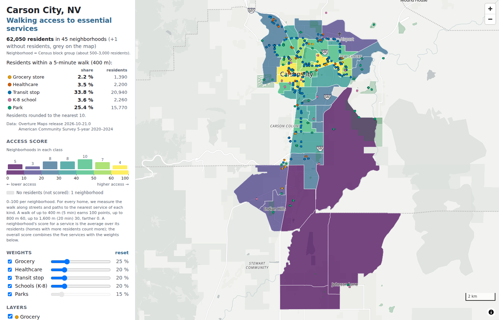

# Walking Access to Essential Services — Carson City, NV

🗺️ **[Live demo](https://xoffvsg.github.io/urban-accessibility/)** *(not yet deployed)*

<!-- TODO (Phase 4): one-paragraph intro — what this is, what it does, why it matters. 3–4 sentences, specific. -->

<!-- TODO (Phase 4):  -->

---

## The question

Which neighborhoods in Carson City have the best — and worst — walking access to essential services
(grocery, healthcare, parks, schools, transit)?

---

## The data

Counts are for the fetch extent: the city bbox plus the block groups scored for it (centroid inside
the bbox), buffered 2 km so services just outside still count.

| Dataset | Features | Source | License |
|---|---|---|---|
| Overture places (`places/place`) | 4,858 | [Overture Maps](https://overturemaps.org), release `2026-10-21.0` | CDLA-Permissive-2.0 |
| Overture buildings | 38,554 | Overture `buildings/building` | ODbL (OSM-derived) |
| Overture road segments / connectors | 16,650 / 24,430 | Overture `transportation` | ODbL |
| Overture park land use | 98 polygons | Overture `base/land_use` (park, dog park, playground, recreation ground) | ODbL |
| Census block groups | 80 (46 scored: 40 Carson City, 6 Douglas County) | TIGER/Line 2024 via [pygris](https://github.com/walkerke/pygris) | Public domain |
| ACS 5-year 2020–2024 | 80 block groups | [Census API](https://www.census.gov/data/developers/data-sets/acs-5year.html): population, age (B01001), income (B19013), vehicles (B25044), income-to-poverty ratio (C17002), with MOEs | Public domain |
| OSM gates and fences | 300 gates / 302 fence lines | [Overpass API](https://overpass-api.de), fetched 2026-10-30 (`barrier=*`) | ODbL, © OpenStreetMap contributors |
| JAC transit stops (GTFS) | 184 served stops | [Jump Around Carson](https://www.carsoncity.gov/government/departments-g-z/public-works/transportation/jac-jump-around-carson) feed via TransLoc | Published by Carson City |

Services come from Overture places, matched on `taxonomy.hierarchy` (see `config/scoring.yaml`). City name
overrides fix mis-tagged grocers (e.g. Raley's is tagged `coffee_shop`, Walmart `department_store`).
Places checked on the ground are dropped or moved one by one (`place_overrides`, keyed by Overture id):
for groceries, one Walmart is now a Ross store, three listed stores don't exist, and one point was moved
to its store, which leaves 12 full-service grocery stores.
Transit uses GTFS, because the Overture transit places here are Greyhound stops and heritage-rail depots.

ACS caveat: at block-group level the coefficient of variation is above 30 % in 34 of the 45 populated
scored block groups for the share of households without a car, in 27 for the share below 200 % of the
poverty line, and in 11 for median income. These fields are shown with their margins of error, and the
equity results carry Monte Carlo ranges (see Findings).

Analysis CRS: **EPSG:32611** (WGS 84 / UTM 11N, metres). Web layers are exported in EPSG:4326.

---

## Methodology

**Extract.** DuckDB reads Overture GeoParquet straight from S3, filtering on the `bbox` columns, for the
bbox plus the scored block groups, buffered 2 km. TIGER block groups and ACS come from pygris and the
Census API. JAC stops come from the GTFS feed.

**Walk network.** All Overture road and path segments except motorways and segments where foot access is
denied, split at Overture connectors into 36,346 undirected edges (cost = length in metres, EPSG:32611)
and loaded into PostGIS. Routing uses the largest connected component, which holds 98.8 % of the network
length. pgRouting 4.0.1 computes the distances.

**Origins: where people live.** Each block group's ACS population is spread over its residential
buildings (dasymetric allocation): 16,735 classified homes, including mobile homes, plus 5,533
unclassified house-sized footprints. Each building is weighted by footprint area × floors. Access is
measured from every home and averaged per block group, weighted by population, so a block group's empty
hills don't count as people without access.

**Distances.** Homes and services are snapped to the nearest walkable edge, not the nearest
intersection, because blocks here are often 100–200 m long. The distance to the nearest service of each
type comes from a single-source driving-distance run out of a virtual node connected to every service.
Multi-source `equicost` in pgRouting 4.0.1 returned non-minimal distances, and the switch was verified
against point-to-point Dijkstra (0.00 m difference on 40 random pairs). Parks are reached at any point
of their boundary within 30 m of a path. Transit means GTFS stops.

**Scoring.** Tiered walk bands: ≤ 400 m (about 5 min) = 1.0, ≤ 800 m = 0.6, ≤ 1,600 m = 0.3, beyond = 0.
Per service, the score is the population-weighted mean × 100. The composite `access_score` is the
weighted sum (grocery 0.25, healthcare 0.20, transit 0.20, schools 0.20, parks 0.15). Scores are absolute,
not rescaled, so other cities are comparable; a city-relative percentile is stored alongside.

**Why block groups.** There are 46 here against roughly a dozen tracts, which is enough resolution to see
neighbourhood differences. The cost is large ACS margins of error (see The data).

**Limitations.** Roads without a mapped sidewalk are treated as walkable. Access rules that apply to
part of a segment are applied to the whole segment. Overture has no barriers (fences, gates). OSM gates
explicitly closed to walkers (`access=no` / `foot=no`, 7 here) are applied automatically; the other
OSM gates (most have no access tag) are not modelled. Gates checked on the ground are drawn as
lines in `carson_city_gates.geojson` (open or closed), and blocked paths are listed by segment id
(`blocked_segments`). Gated
communities are drawn as polygons whose only connections are their real gates (`gated_areas`); so far two
adjoining ones off Fairview Dr and S Saliman Rd (136 and 108 homes), each with a single exit. Overture place categories need city-specific
corrections (see `config/cities/carson_city.yaml`). Healthcare still includes some specialist clinics
that Overture tags as general clinics.

---

## Findings

<!-- Draft from notebooks/06_equity_analysis.ipynb (numbers regenerate with `make equity`).
     TODO (Phase 4): headline sentence for the intro, top/bottom table, screenshot. -->

All numbers are for the 62,051 residents of the 45 populated scored block groups. Ranges in brackets
are the 5th–95th percentiles of 1,000 Monte Carlo draws from the ACS margins of error.

**A 5-minute walk to a grocery store is rare.** 1,290 residents (2.1 % [1.9–2.3]) live within 400 m
of one of the 12 full-service grocery stores, measured along the walking network; 41.1 % have none
within 1,600 m (about 20 minutes). Another 3,690 (5.9 %) have a convenience store but no grocery
within 400 m. Transit is the most walkable service (32.7 % within 400 m of a JAC stop), then parks
(23.0 %); healthcare (2.2 %) and K-8 schools (3.3 %) are as rare as groceries.

**Access is better where incomes are lower.** The lowest-income third of residents (block-group median
household income $34k–61k) has a mean access score of 47.5; the highest-income third ($82k–143k) has
23.3. Across block groups, Spearman ρ between the access score and median household income is −0.59
(MC range −0.60 to −0.30), and +0.45 with the share of residents below 200 % of the poverty line.
Residents below that line are more likely than average to be within 400 m of a transit stop (46.4 %
[42.7–50.0] vs 32.7 %) and of a grocery store (3.1 % vs 2.1 %); so are households without a car
(43.5 % and 3.8 %).

**Older residents have less access.** 1.6 % [1.3–1.8] of residents 65+ live within 400 m of a
grocery store, and their mean access score is 31.1 against 34.2 for all residents (ρ with the 65+
share: −0.34).

**Low access clusters in the south.** The access score is strongly clustered (global Moran's I = 0.64,
p = 0.0001, 9,999 permutations). Local Moran's I finds 8 low-low block groups at p < 0.05 (6 after a
false-discovery-rate correction), all between 39.03 °N and 39.12 °N: the Douglas County block groups
and two at the south end of Carson City. The 6 high-high block groups (3 after correction) lie further
north, at 39.17–39.18 °N.

These are block-group comparisons (ecological inference): a group is assumed to live in its block
group's homes like everyone else.

---

## Tech stack

<!-- TODO (Phase 4): full stack list with a one-line reason per tool. The environment and
     database choices are already documented in the next section. -->

---

## Development environment

This project was built on a Windows 10 desktop using **VS Code attached to WSL2 Ubuntu**, with a bash terminal,
a conda environment inside Ubuntu, and PostGIS + pgRouting in a Docker container. That is not the
simplest setup that would have worked, and the reasons are recorded here.

A Windows 11 laptop is the second machine, synced through GitHub. It has not been set up for this
project yet; any differences found when repeating the setup there will be added below.

<!-- TODO (laptop setup): note what differed on Windows 11 / the laptop, if anything. -->

### Why WSL2 Ubuntu

- **One Linux toolchain.** GDAL/ogr2ogr, tippecanoe, `psql`, DuckDB and Python all come from a
  single conda-forge environment (`environment.yml`) in Linux. It avoids mixing Windows and Linux
  builds, and it sidesteps an older Windows Anaconda GDAL (3.6) whose `ogr2ogr` crashes on exit.
- **The brief asked for a bash terminal**, and bash scripts and Makefiles run unchanged in Linux.
- **Deliberate experiment.** I had already done comparable projects without WSL
  ([nyc-hydrant-analysis](https://github.com/xoffvsg/nyc-hydrant-analysis),
  [nyc-hydrant-map](https://github.com/xoffvsg/nyc-hydrant-map) — including tippecanoe), so WSL
  was **not required**. I used it here to compare the two ways of working.

The project folder stays on the Windows drive (`C:\dev\PortfolioProject4\Urban_Accessibility`,
`/mnt/c/...` in WSL), so QGIS and pgAdmin on Windows can open the same files.

### Why a Docker container for the database

- **pgRouting comes with the image.** The `kartoza/postgis` image ships PostGIS and pgRouting
  (here PostgreSQL 18.6, pgRouting 4.0.1). Native Windows PostgreSQL needs pgRouting added separately.
- **Isolation.** The machine also has native PostgreSQL 14, 16 and 18 installs. The container has its
  own port (5436), its own data volume and its own versions, so nothing collides.
- **Shared, but separated.** The same container serves other projects. This project only uses its own
  database (`urban_access`) and one schema per city.
- **Same behaviour on every machine.** The desktop and the laptop run the same image, so SQL written
  on one runs on the other.

Is a server database necessary at all? Not for the data size: Carson City fits easily in memory, and
DuckDB alone could do most of the spatial joins. The database is justified by **pgRouting** (network
walking distances) and by the course goal of practising a PostGIS workflow. A pure-Python alternative
would be OSMnx/NetworkX on an OpenStreetMap walk network.

### Extra steps WSL added (one-time)

| Step | Why it was needed |
|---|---|
| Install the VS Code **WSL** extension, then *Open a WSL Window* / `code .` from Ubuntu | VS Code runs a server inside Ubuntu |
| Reinstall Python, Jupyter, Claude Code extensions **on the WSL side** | Extensions installed for Windows don't apply to WSL windows |
| Install **Miniforge in Ubuntu**, create the env, select the interpreter by path | Windows conda environments aren't visible from Linux |
| `git config core.fileMode false`, `core.autocrlf input`, `.gitattributes` with LF | Files on `/mnt/c` look executable to Linux; Windows and Linux use different line endings |
| Set **git identity** and a **credential helper** in WSL | WSL git has its own config, separate from Windows git |
| Install the **Claude Code CLI inside Ubuntu** (`curl -fsSL https://claude.ai/install.sh \| bash`) and add `~/.local/bin` to the PATH | A Windows install isn't visible from WSL, and the VS Code extension doesn't provide the `claude` terminal command. Reloading `~/.bashrc` afterwards drops back to `(base)`, so `conda activate urban-access` is needed again before starting `claude` |
| Know the **Ubuntu user password** for `sudo` | Needed for `apt-get` (e.g. the `psql` client) |
| Fix `docker ps` → *permission denied* on `docker.sock` | Docker Desktop's WSL integration plus membership of the `docker` group. Not needed for the project itself, which connects through port 5436 |
| `playwright install chromium`, then `sudo apt-get install libnss3 libnspr4 libasound2t64` | Headless Chromium for testing the web map and the README screenshot; the browser download lives in `~/.cache/ms-playwright`, and Ubuntu lacked three system libraries it needs (on Windows the browser brings its own) |
| Dismiss the *"workspace is on the Windows file system"* warning | The repo is on `C:` on purpose; file access from WSL is slower there |

Issues that came up during setup but **were not caused by WSL** (they'd happen on Windows too):
`psql` waiting at `(END)` (pager; use `-P pager=off`), `load_dotenv()` failing from a heredoc script
(pass an explicit `.env` path), DuckDB 2.0 removing `.fetchone()` on relations, and pgRouting 4 removing
`pgr_createTopology` and related functions. Another one: a process started by VS Code (here the Claude
Code extension) can have the env's `bin/` on its PATH without `conda activate` having run. Then conda's
activation scripts don't set `PROJ_DATA`, and pyogrio/GDAL print `PROJ: proj_create_from_database: Open
of …/share/proj failed`. The package sets `PROJ_DATA` from `sys.prefix` when it's missing
(`src/urban_access/__init__.py`). And one more: conda-forge's `gdal` package installs only
`libgdal-core`, which has neither the Parquet nor the PostgreSQL driver, so `ogr2ogr file.parquet PG:…`
failed until the `libgdal-arrow-parquet` and `libgdal-pg` plugins were added to `environment.yml`.

### What could have been done differently

- **Windows-native, as in my earlier projects:** a Windows conda environment, VS Code with Git Bash,
  and the same Docker container. That avoids every step in the table above; tippecanoe can run as it
  did in nyc-hydrant-map.
- **Hybrid:** stay on Windows and use WSL only for a single command (e.g. `wsl tippecanoe …`).
- **All-Linux:** keep the repo in the Linux filesystem (`~/dev/...`) for faster I/O, at the cost of
  Windows tools reaching it through `\\wsl$\Ubuntu\...`.
- **Define the database in the repo:** add a `docker-compose.yml` that pins the image and enables
  pgRouting, so a reader can reproduce the database with one command instead of relying on an
  existing container.

<!-- TODO (end of project): add a verdict on the experiment — did WSL pay off in daily use? -->

---

## How to reproduce

<!-- TODO (Phase 4): three commands or fewer. Full environment steps are in SETUP.md. -->

Requires: Windows with WSL2 Ubuntu (or any Linux/macOS), conda (Miniforge), and a PostgreSQL server with
PostGIS and pgRouting (Docker `kartoza/postgis` used here). See [SETUP.md](SETUP.md).

```bash
conda env create -f environment.yml && conda activate urban-access   # once; then fill .env
make all CITY=carson_city      # extract → network + scores → equity → docs/data/*.pmtiles
make serve                     # http://localhost:8000
```

RangeHTTPServer is used instead of `python -m http.server` because PMTiles reads byte ranges of the
tile file, which the built-in server does not support.

---

## What I learned

<!-- TODO (end of project): written by me, in first person. -->

---

## Author

<!-- TODO -->

---

## License

<!-- TODO: MIT for code; data licenses listed under "The data". -->
